# ClearPort — Database

SQLite (WAL mode) accessed through Prisma 7 with the `better-sqlite3` driver adapter. The schema is
[`backend/prisma/schema.prisma`](../backend/prisma/schema.prisma); migrations are in
[`backend/prisma/migrations`](../backend/prisma/migrations).

## Conventions

| Topic | Rule |
|---|---|
| Primary keys | UUID strings (`uuid()`), stored as TEXT |
| Money / rates | TEXT decimal strings (`"1000.0000"`, rates 10 dp). **Never floats.** Compute only with `src/common/money.ts` (decimal.js) |
| Timestamps | Prisma `DateTime`, UTC |
| Tenant scope | Every tenant-owned row has `tenantId NOT NULL` and `@@unique([tenantId, id])` |
| Tenant safety | Child tables use **composite FKs** `(tenantId, parentId) → parent(tenantId, id)`, so a row can never reference another tenant's row — enforced by SQLite, verified by `test/tenant-isolation.test.ts` |
| Membership safety | `assignedTo` / `createdBy` / task owners reference `tenant_users(tenantId, userId)`, so they must have a membership row in the same tenant. The FK cannot check `isActive`; the service layer must also require an active membership |
| System rows | `roles`, `document_types`, `system_settings`, `notification_templates` use `tenantId = NULL` for system defaults. SQLite treats NULLs as distinct in UNIQUE, so triggers enforce uniqueness of NULL-tenant rows |
| Deletes | Composite FKs are `ON DELETE RESTRICT`. Financial rows are never deleted (triggers) |
| Column names | camelCase columns, snake_case plural table names (`@@map`) |

### Exchange-rate convention

`rate` is "units of base currency per 1 unit of the transaction currency" (`BASE_PER_FOREIGN`).
Each transaction stores its own `exchangeRate`, `rateConvention`, `rateSource` and `baseAmount`;
`exchange_rates` is append-only (trigger), so historical rates are never overwritten.

## Rules enforced by the database (migration `integrity_triggers`)

These are a backstop. The service layer must validate first and translate the trigger message
(`src/common/db-errors.ts`) into a domain error.

| Rule | Mechanism |
|---|---|
| Posting needs ≥ 2 lines and `Σ base debit = Σ base credit` | trigger on `journal_entries.status` DRAFT→POSTED |
| Posted entries immutable; only `POSTED → REVERSED` allowed, nothing else changes | triggers on `journal_entries` / `journal_entry_lines` |
| Journal line is one-sided and non-negative | trigger |
| Issued invoices frozen (number, client, file, currency, totals, items); cancelled invoices stay cancelled | triggers on `invoices`, `invoice_items` |
| Posted payments / approved expenses keep amount, currency and historical rate | triggers |
| No physical delete of invoices, payments, allocations, expenses | triggers |
| Append-only: `exchange_rates`, `audit_logs`, `file_status_history`, `document_versions` | triggers |
| `file_number` never changes | trigger |
| Unique system role / document-type / global setting / template codes | triggers |

Not in the database (service layer): currency match on allocations, over-allocation of an invoice,
transition validation, permission checks, file-number allocation transaction, ISO 6346 validation.

### Added for Phase 5 (migration `finance_phase5`)

| Addition | Reason |
|---|---|
| `invoices.exchangeRate / rateConvention / rateSource / baseTotalAmount` | spec 6.1: an invoice is a transaction and keeps the rate it was issued at; frozen once issued (trigger) |
| `invoice_items.taxRate / taxAmount / expenseId` | per-line tax snapshot; link to the pass-through expense being re-billed |
| `financial_categories.isTaxable` | which categories carry the office's tax |
| `expenses.cashAccountId / paidAt / cancelledAt / cancelReason` | payment and cancellation of expenses |
| `payment_allocations.paymentAmount / paymentBaseAmount / invoiceBaseAmount / reversedAt / reversalReason / createdBy` | cross-currency allocation, exact base values, and reversal instead of deletion |
| triggers `payment_allocations_immutable`, `payment_allocations_reversal_final`, `invoices_rate_frozen` | allocations and invoice rates cannot be altered; a reversal is final |

> **SQLite trap:** adding columns makes Prisma rebuild the table (create new / copy / DROP old / rename), and `DROP TABLE`
> silently drops that table's triggers. The migration re-creates the affected triggers, and `test/migrations.test.ts` fails if
> any trigger declared by any migration is missing from the migrated database. Keep doing both for future column additions.

## Number sequences

`number_sequences(tenantId, docType, year, lastValue)`; allocate with `nextDocumentNumber()`
(`src/common/numbering.ts`): a single atomic `INSERT … ON CONFLICT DO UPDATE … RETURNING`, inside the
same transaction that creates the record, so a rollback also rolls the number back. Never `MAX()+1`.

## ERD

Key relationships (columns omitted for readability; see the schema for all fields). Every
tenant-owned entity also has an N:1 link to `TENANT`, not drawn to keep the diagram legible.

```mermaid
erDiagram
    TENANT ||--o{ TENANT_USER : has
    USER ||--o{ TENANT_USER : "member of"
    TENANT ||--o{ BRANCH : has
    TENANT_USER ||--o{ USER_ROLE : "granted"
    ROLE ||--o{ USER_ROLE : "assigned as"
    ROLE ||--o{ ROLE_PERMISSION : has
    PERMISSION ||--o{ ROLE_PERMISSION : "included in"
    USER ||--o{ REFRESH_SESSION : owns

    TENANT ||--o{ CLIENT : has
    CLIENT ||--o{ CLIENT_CONTACT : has
    TENANT ||--o{ BUSINESS_PARTY : has

    CLIENT ||--o{ CLEARANCE_FILE : "primary client of"
    BRANCH |o--o{ CLEARANCE_FILE : "handles"
    TENANT_USER |o--o{ CLEARANCE_FILE : "assigned to"
    WORKFLOW_TEMPLATE ||--o{ WORKFLOW_STAGE : has
    WORKFLOW_TEMPLATE ||--o{ WORKFLOW_TRANSITION : has
    WORKFLOW_STAGE |o--o{ CLEARANCE_FILE : "current stage"
    CLEARANCE_FILE ||--o{ FILE_STATUS_HISTORY : "stage history"
    CLEARANCE_FILE ||--o{ FILE_ACTIVITY : timeline
    CLEARANCE_FILE ||--o{ TASK : has
    TENANT_USER ||--o{ TASK : "assigned"

    CLEARANCE_FILE ||--o{ SHIPMENT : has
    SHIPMENT ||--o{ CONTAINER : has
    SHIPMENT ||--o{ GOODS_ITEM : has
    HS_CODE |o--o{ GOODS_ITEM : classifies
    HS_CODE ||--o{ HS_CODE_VERSION : "versioned by"
    PORT |o--o{ SHIPMENT : "origin / destination"
    BUSINESS_PARTY |o--o{ SHIPMENT : "agent / forwarder"

    DOCUMENT_TYPE ||--o{ DOCUMENT : categorises
    CLEARANCE_FILE ||--o{ DOCUMENT : has
    DOCUMENT ||--o{ DOCUMENT_VERSION : "kept as"
    DOCUMENT_TYPE ||--o{ DOCUMENT_REQUIREMENT : "required by"
    WORKFLOW_STAGE |o--o{ DOCUMENT_REQUIREMENT : "needed before"

    CLEARANCE_FILE |o--o{ EXPENSE : incurs
    FINANCIAL_CATEGORY ||--o{ EXPENSE : classifies
    BUSINESS_PARTY |o--o{ EXPENSE : "vendor"
    CLEARANCE_FILE ||--o{ INVOICE : billed
    CLIENT ||--o{ INVOICE : "billed to"
    INVOICE ||--o{ INVOICE_ITEM : has
    FINANCIAL_CATEGORY |o--o{ INVOICE_ITEM : classifies
    CLIENT |o--o{ PAYMENT : pays
    CASH_ACCOUNT ||--o{ PAYMENT : "received into"
    PAYMENT ||--o{ PAYMENT_ALLOCATION : "split into"
    INVOICE ||--o{ PAYMENT_ALLOCATION : "settled by"
    CURRENCY ||--o{ EXPENSE : denominates
    CURRENCY ||--o{ INVOICE : denominates

    CHART_OF_ACCOUNT |o--o{ CHART_OF_ACCOUNT : parent
    CHART_OF_ACCOUNT |o--o{ CASH_ACCOUNT : "ledger for"
    JOURNAL_ENTRY ||--o{ JOURNAL_ENTRY_LINE : has
    CHART_OF_ACCOUNT ||--o{ JOURNAL_ENTRY_LINE : "posted to"
    JOURNAL_ENTRY |o--o| JOURNAL_ENTRY : "reversal of"
    CLEARANCE_FILE |o--o{ JOURNAL_ENTRY_LINE : "analysed by"

    TENANT ||--o{ NUMBER_SEQUENCE : "numbers"
    TENANT ||--o{ EXCHANGE_RATE : "rates"
    TENANT ||--o{ AUDIT_LOG : records
    TENANT ||--o{ NOTIFICATION : sends
    TENANT ||--o{ JOB : queues
```

## Entity inventory vs. specification

All 11.1 – 11.7 entities are implemented (50 tables). Additions beyond the spec's field lists, each
justified by a spec rule:

| Addition | Reason |
|---|---|
| `refresh_sessions` (+ `familyId`) | spec 11.1: hashed, rotating, revocable refresh tokens; reuse detection |
| `clearance_files.workflowTemplateId` | spec 14.3: backend selects a workflow template at creation |
| `workflow_transitions.requiresReason / requiredTaskCheck` | spec 5.2: transitions may require a reason or completed tasks |
| `exchange_rates.convention`, `rateConvention` / `rateSource` on transactions | spec 6.1: preserve direction and source |
| `financial_categories.costTreatment` | spec 6.2 / 6.5: pass-through vs. office expense vs. revenue |
| `expenses.paidBy / status`, `invoices.issuedAt / cancelledAt / cancelReason` | spec 6.4 / 6.5: controlled cancellation, on-behalf expenses |
| `cash_accounts.ledgerAccountId` | links a cashbox to its ledger account for posting |
| `documents.deletedAt` | `DELETE /documents/:id` is a soft delete (void) |
| `jobs` | spec 18.4 SQLite-backed queue |
